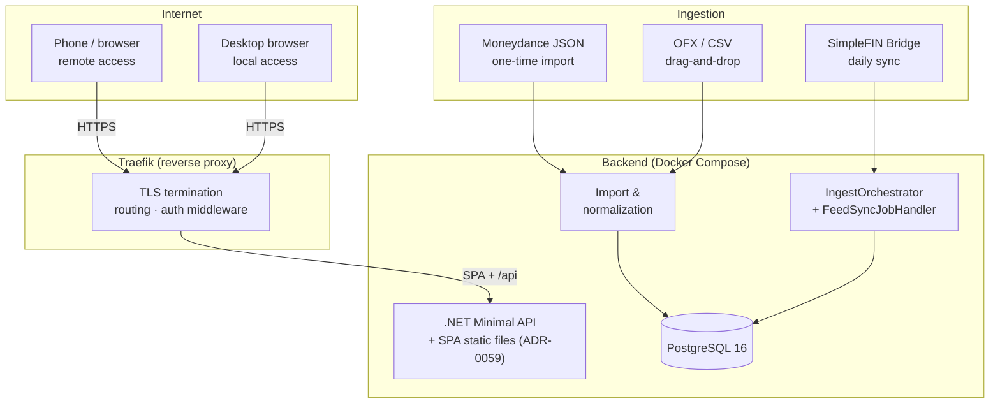
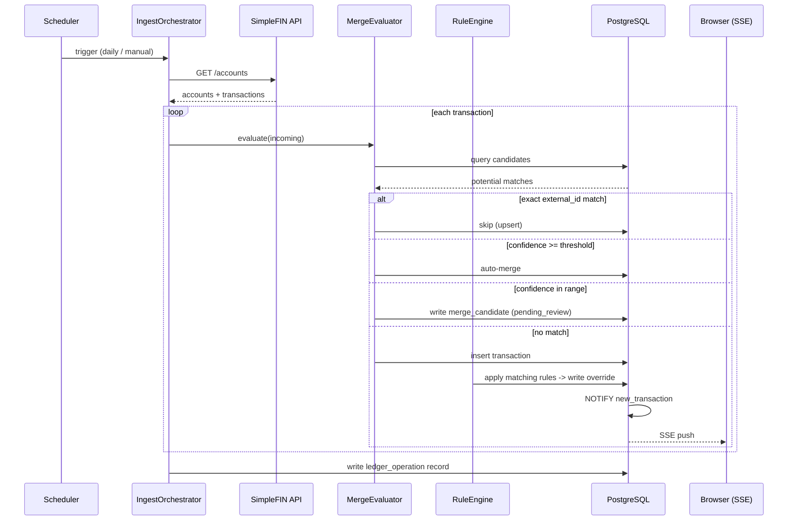
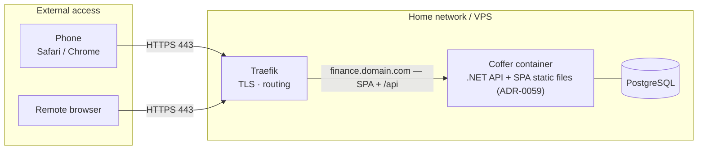
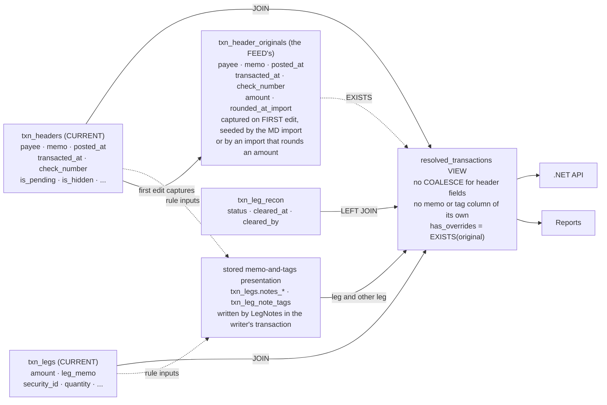
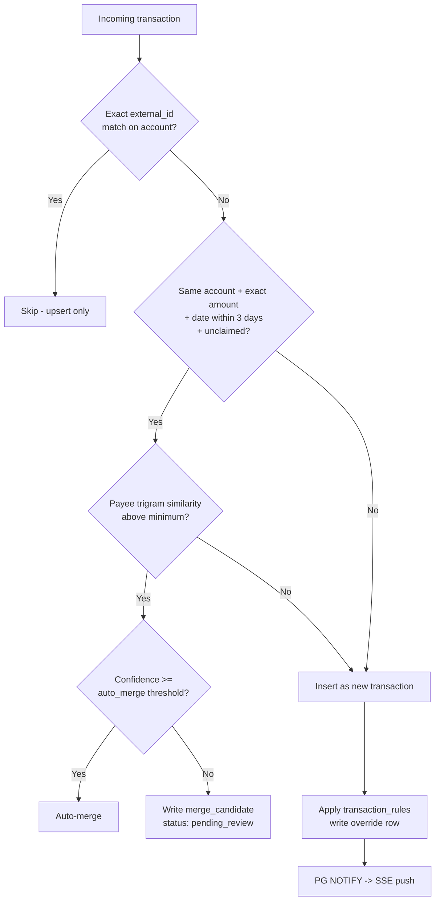
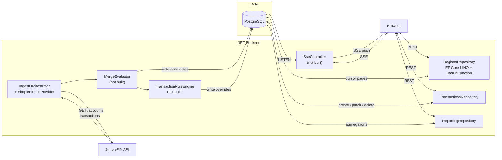
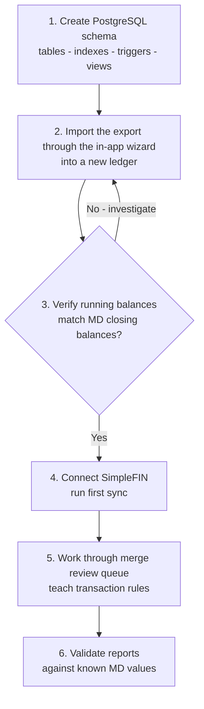

# Coffer — Architecture & Design Reference

*A self-hosted Moneydance replacement built on .NET + PostgreSQL.*

**Source of truth.** This document is the authoritative high-level design.
Deviations are captured in [decisions/](decisions/) (ADRs) and in implementation-level
docs ([database-schema.md](database-schema.md), [operations.md](operations.md)).

---

## Table of Contents

1. [Project Overview](#1-project-overview)
2. [System Architecture](#2-system-architecture)
3. [Data Model](#3-data-model)
4. [Current Values and Captured Originals](#4-current-values-and-captured-originals)
5. [Transaction Merge Pipeline](#5-transaction-merge-pipeline)
6. [Implementation Notes](#6-implementation-notes)
7. [Moneydance Migration Plan](#7-moneydance-migration-plan)
8. [Build Sequence](#8-build-sequence)

---

## 1. Project Overview

Coffer is a self-hosted personal finance application intended to replace Moneydance.

### 1.1 Goals

- Replace Moneydance and the Moneydance+ Plaid feed with a self-hosted, containerized alternative
- Preserve years of historical Moneydance data with full fidelity
- Provide a contemporary web-based UI with interactive reports
- Maintain a proper double-entry accounting model matching Moneydance's internal design
- Support live bank feed sync via SimpleFIN Bridge
- Handle investment accounts, holdings, and tax-lot tracking
- Support multiple users with per-ledger access roles (owner / editor / viewer), member + admin management, and invite links (ADR-0083, delivered 0.34.0)

### 1.2 Non-goals and deferred work

Two different things, kept apart on purpose: a non-goal is a decision not to build
something, a deferral is work that is queued.

**Non-goals** — not planned:

- Native mobile apps (the SPA is responsive; no native app)
- Direct OFX/direct-connect banking (SimpleFIN covers this)

**Deferred** — intended, not scheduled:

- Tax-lot selection UI. The schema supports it and the per-security "Edit Lots"
  affordance is a shaped, queued item in the maintainer backlog — it waits on the
  editor and FIFO lot-closure work, not on a decision.

### 1.3 Technology stack

| Layer | Technology |
|---|---|
| Backend API | **.NET 10** (LTS) — Minimal API style. See [decisions/0011-target-dotnet-10.md](decisions/0011-target-dotnet-10.md). |
| ORM / data access | **EF Core end-to-end** in the API (LINQ for queries; `HasDbFunction` for complex Postgres functions; `ExecuteUpdate`/`ExecuteDelete` for set-based mutations). Dapper stays in the importer for its bulk-insert hot path. See [decisions/0005-dapper-and-efcore.md](decisions/0005-dapper-and-efcore.md) as realigned in PR 3.6.5. |
| Database | PostgreSQL 16+ |
| Caching | None. Redis was provisioned but never wired and was removed in v0.5.0; the product is single-instance self-hosted. A cache (report/balance, or a distributed sync lock) is a later call if a multi-instance shape ever lands. |
| Real-time | **Not built.** ADR-0012 chose Server-Sent Events over SignalR/WebSockets *when* real-time lands, and that choice stands — but no SSE endpoint, no `LISTEN`/`NOTIFY` and no push of any kind exists in the app today. The SPA refreshes by invalidating React Query keys (ADR-0079). ADR-0096 states the position plainly: Coffer has no way to tell anyone anything. See [decisions/0012-sse-and-plain-http-no-signalr.md](decisions/0012-sse-and-plain-http-no-signalr.md). |
| Authentication | WebAuthn / FIDO2 passkeys (YubiKey, Windows Hello, Touch ID, phone) via `Fido2.AspNet`; multi-credential per account; one-time recovery codes; cookie session. See [decisions/0013-webauthn-passkey-auth.md](decisions/0013-webauthn-passkey-auth.md). |
| API documentation | Built-in OpenAPI generator (`Microsoft.AspNetCore.OpenApi`, .NET 10 in-box) |
| Frontend | Vite + React + TypeScript + Tailwind v4 + TanStack Query + TanStack Router + react-virtuoso. UI primitives are hand-rolled in the shadcn/ui idiom (`class-variance-authority` + `cn(twMerge(clsx))`), not pulled via the shadcn CLI — see ADR-0021 + `src/Web/src/components/ui/` for the in-repo primitives (Button, Typeahead, ContextMenu, ConfirmDialog, StatusBadge, etc.). |
| Charts | **No charting library.** ADR-0099 decided against one: the single chart in the product (`SpendCurve`) is hand-rolled inline SVG. `package.json` carries neither Recharts nor Nivo. |
| Containerization | Docker Compose — postgres + the single-container api/spa (ADR-0059) |
| Reverse proxy | Traefik — TLS termination, routing, internet-accessible |
| Bank feed | SimpleFIN Bridge (via MX) — a low flat subscription, up to 25 institutions |

> **Frontend choice rationale:** Vite + React SPA was chosen over Next.js because Next.js's primary value propositions (SSR, SSG, full-stack deployment) add complexity without benefit for a single-user app backed by a dedicated .NET API. The SPA builds to static files served via Traefik or directly from the .NET app as static middleware. See [decisions/0007-react-spa-over-nextjs.md](decisions/0007-react-spa-over-nextjs.md).

---

## 2. System Architecture

### 2.1 Three-layer overview



> The diagram draws no SSE edge and no `LISTEN`/`NOTIFY` edge because neither
> exists — see §2.2. The SPA learns about a completed sync by
> invalidating its own query keys, not by being told.

### 2.2 Real-time / streaming — **planned, not built**

> **Status (2026-09-24): none of this exists.** There is no SSE endpoint, no
> `LISTEN`/`NOTIFY`, and no push of any kind. The SPA keeps itself current by
> invalidating React Query keys after its own writes (ADR-0079); a change made in
> another tab, by MCP, or by a background sync is not pushed. ADR-0096 says it
> outright: Coffer has no way to tell anyone anything.
>
> The section is kept because the DECISION stands — when real-time lands it will be
> SSE, not SignalR — and because the diagrams in §2.1 and §2.3 still show the intended
> shape. Read the tables below as the design, not as the system.

Two patterns, picked for the actual usage shape (single user, server-pushed sync events, button-triggered actions). See [decisions/0012-sse-and-plain-http-no-signalr.md](decisions/0012-sse-and-plain-http-no-signalr.md) for the trade-off analysis.

| Pattern | Use case |
|---|---|
| **Server-Sent Events** (`text/event-stream` via `System.Net.ServerSentEvents`) | Every server-to-browser stream: sync progress, new-transaction notifications, pending-review-count updates. |
| **Plain HTTP `POST`** | Every browser-to-server command, including manual sync triggers. Combined with the SSE channel above, this covers what some apps reach for SignalR to do. |
| **PostgreSQL `LISTEN`/`NOTIFY`** | Backend pub/sub — sync worker publishes to a channel; API controller subscribes via Npgsql and fans out to SSE clients. |

**No SignalR, no WebSockets.** SignalR's strengths (multi-client fan-out, transport negotiation, backplane) are sized for many users on flaky networks across multiple replicas, which Coffer is not. The "bidirectional" interaction in this app is a command followed by a streamed status — natively HTTP-shaped.

### 2.3 Sync pipeline flow — **the intended shape, partly built**

> The sequence below shows `MergeEvaluator`, auto-merge by confidence score, a rules
> engine and an SSE push. **None of those four exist.** What ships: the orchestrator
> dedups on `external_id`, inserts unmatched rows with `needs_review = true`, and the
> user merges by hand from the editor's "Merge candidates" strip. Auto-merge was
> abandoned rather than deferred — see the merge pipeline section — and the rules
> engine is still an open backlog item.




### 2.4 Bank feed — SimpleFIN

SimpleFIN Bridge is the chosen feed provider. Key characteristics:

- Cost: a low flat subscription, billed monthly or yearly (check the vendor's current pricing)
- Supports up to 25 institutions and 25 apps
- Daily polling — not real-time; appropriate for personal finance
- Uses MX as upstream aggregator
- Institutions that authenticate the aggregator by OAuth need no screen-scraping
- An OAuth token persists until expiry, then the user must re-authenticate; an account protected by a hardware security key needs the physical key to do so
- SimpleFIN returns account balances, transactions, and holdings (including security positions) for investment accounts

See [decisions/0006-simplefin-over-plaid.md](decisions/0006-simplefin-over-plaid.md) for the comparison vs Plaid.

> **Note:** Design the app to gracefully handle a 'needs re-auth' state for a connection. Surface it clearly in the UI and make re-auth a one-click prompt rather than a silent failure.

### 2.5 Deployment — localhost, or a reverse proxy for remote access

Two supported shapes, chosen at install time. **One machine** is the default and a
complete deployment: `http://localhost` on the host, nothing published beyond it, every
feature working. The diagram below is the **other** shape — opt-in remote access, where
a reverse proxy (Traefik here) terminates TLS so the same install is reachable from a
phone or a browser outside the home network. Nothing in the architecture requires it.



> **SSE buffering:** The `X-Accel-Buffering=no` header on the API router is required. Without it Traefik buffers SSE responses and the real-time sync feed loses its low-latency behaviour.

### 2.6 Authentication

Authentication and network posture are independent concerns. The app enforces auth in every environment regardless of how it's exposed (LAN-only, VPN, public-internet behind a reverse proxy). Network posture is a deployment decision documented in [operations.md](operations.md).

The chosen scheme is **WebAuthn / FIDO2 passkeys**, fully detailed in [decisions/0013-webauthn-passkey-auth.md](decisions/0013-webauthn-passkey-auth.md). Summary of the user-visible model:

| Element | Behaviour |
|---|---|
| Primary credentials | Any FIDO2 authenticator: YubiKey (USB / NFC), Windows Hello, Touch ID / Face ID, Android passkey, iPhone passkey. |
| Multiple credentials per account | No upper bound. Each is nicknamed by the user and labelled by AAGUID + transports in the UI. |
| Recovery codes | 10 single-use, Argon2id-hashed at setup. Each unlocks one re-registration. Regeneratable from an authenticated session. |
| Bootstrap (first run) | API logs a one-time setup token on first start while no credentials exist; the operator shares `/setup/{token}` (`dev-up-docker.sh` prints it). The setup page fetches `GET /api/auth/setup/{token}/info` on mount purely to validate the token — it returns no ledger list (ADR-0088) — then the user supplies a username, display name and passkey label before the WebAuthn ceremony. `/complete` returns plaintext recovery codes once; the SPA shows Copy / Download .txt / Print affordances and gates the post-setup navigation to the ledger hub (`/`) behind explicit acknowledgement. Setup creates no ledger and asks no ledger question. The hub's **Demo ledger** action (`POST /api/ledgers/demo`) generates a Demo for the caller's date and builds it as a background import job through `ImportJobRunner`, which the hub follows with `GET /api/ledgers/demo/job`. After the import commits, the same job's examples phase (`DemoSeeder`) adds what an export cannot carry through the API's own repositories, recording each step on the Demo's `ledger_operations` row (provider `demo`); a startup sweep (`DemoMarkerSweep`) closes a row a restart left running (ADR-0115). |
| Sessions | Cookie-based (`HttpOnly`, `Secure`, `SameSite=Strict`); 30-day max lifetime, 7-day idle timeout, multi-session, "sign out everywhere" available. |
| Library | [`Fido2.AspNet`](https://github.com/passwordless-lib/fido2-net-lib) on the server side. |

**Key property: works fully offline.** The auth ceremony is server ↔ browser ↔ device crypto; no IdP is in the path. A WAN outage does not prevent fresh login from a LAN- or VPN-reachable client.

The .NET API enforces authentication directly (the API is *not* auth-naive). A `Development`-only handler bypass is gated by `Api:DevAuth=true` plus `ASPNETCORE_ENVIRONMENT=Development`, and only authenticates a request that also sends the opt-in header `X-Dev-Auth: 1` — so it never hijacks a real cookie session. It exists only in a build compiled with it: Debug builds, and the Release build the tests run against (`-p:CofferDevAuth=true`). The published image is a Release build without it, so it has no dev-auth code at all, whatever its environment and configuration say, and always validates real WebAuthn assertions.

### 2.7 Mobile (phone browser) considerations

The Vite + React SPA works in Safari on iOS and Chrome on Android without any native app. Key design decisions for mobile:

- **Register layout:** a dense spreadsheet-style column grid is unusable on a narrow screen. Use a responsive layout that switches to a card-per-transaction view (amount + payee + date + category) at narrow viewports. react-virtuoso works correctly in both layouts.
- **Touch targets:** shadcn/ui components are touch-friendly by default. Ensure action buttons (categorize, hide, split) have minimum 44px touch targets.
- **Reports / charts:** there is no chart library to be responsive (ADR-0099). The one chart, `SpendCurve`, is inline SVG with a `viewBox`, which scales by construction.
- **Merge review queue:** the side-by-side comparison view needs to stack vertically on mobile — design as a column layout with a clear "match" / "no match" action bar at the bottom of the screen.

---

## 3. Data Model

### 3.1 Core principle — unified accounts table

Moneydance is a genuine double-entry accounting system. Confirmed by Moneydance support: *"Categories are accounts. They are accounts with type income or expense."* When a grocery purchase is recorded in checking, Moneydance creates a corresponding entry in the Groceries expense account.

**Consequence for schema design:** there is one `accounts` table. "Categories" (income/expense) are rows in that table with the appropriate `account_type`. Splits reference accounts by FK — not a separate categories table. See [decisions/0002-unified-accounts-table.md](decisions/0002-unified-accounts-table.md).

### 3.2 Account types

| `account_type` | Description |
|---|---|
| `bank` | Checking, savings, money market |
| `credit_card` | Credit cards — balance represents current debt |
| `investment` | Brokerage, IRA, 401k — the cash-side parent. Per-security positions live in `holdings`, not in `accounts`. |
| `asset` | Property, vehicles, other assets |
| `liability` | Generic liabilities without amortization (e.g. money owed to a person) |
| `loan` | Amortizing loans (mortgages, auto loans) — distinct from `liability` because loans carry payment-schedule metadata (APR, term, compounding). See [decisions/0016-moneydance-account-translation.md](decisions/0016-moneydance-account-translation.md). |
| `category` | Budgeting concept — the "other side" of income/spending transactions. The income-vs-expense distinction lives in `category_kind`, not in this column. See [decisions/0017-account-discriminator.md](decisions/0017-account-discriminator.md). |

`category_kind` is `'income'`, `'expense'` or `'adjustment'`, set if and only if `account_type = 'category'`. **`adjustment`** was added by migration 224 (amending ADR-0017) for entries that are neither earned nor spent — a property revaluation booked as an expense category is subtracted from that month's spending, and one larger than the month's genuine spending drives the total negative; booked against income, the same entry can turn a year's income negative. A report that sums {income, expense} and ignores `adjustment` reintroduces exactly that.

**Hierarchy.** `parent_id` is a self-referencing FK and is only allowed on `category` rows (enforced by CHECK constraint). Real-account hierarchy (e.g. a placeholder parent grouping several accounts at one bank in a Moneydance file) is **not** modelled on `accounts`; the importer makes those flat top-level accounts. Grouping real accounts is what sidebar folders are for: `account_folders` holds a tree per account type, and `account_folder_members` puts an account in at most one folder of its own type ([ADR-0106](decisions/0106-folders-replace-tabs.md)). Categories form a tree freely — a parent category can have its own direct transactions and child categories, both, or neither. There is no `is_placeholder` column; the "this is just a folder" property is derived in the UI as "has children AND no own transactions".

**Investment account hierarchy.** MD models per-security positions as `acct` rows of type `s` parented to the brokerage account. In our schema those become rows in `holdings`, not in `accounts` — see [decisions/0016-moneydance-account-translation.md](decisions/0016-moneydance-account-translation.md).

**Per-brokerage Holdings sibling.** Every `account_type='investment'` row gets a system-managed sibling account at the root that hosts the holdings-side legs of investment transactions (the asset side of buys, sells, dividend reinvests, etc.). The brokerage row points at it via `holdings_account_id`; the sibling carries `is_system=TRUE` and is hidden from the user's account list by default. This pattern keeps the *parent-only-for-categories* invariant intact while giving each brokerage a paired account for the symmetric posting model. See [decisions/0019-symmetric-postings.md](decisions/0019-symmetric-postings.md).

### 3.3 Entity-relationship diagram

The full ERD lives in [database-schema.md](database-schema.md) alongside the column-level reference. Table list:

| Table | Purpose |
|---|---|
| `accounts` | Both real accounts and income/expense categories |
| `feed_connections` | Bank feed credentials/state (SimpleFIN, Plaid, manual) |
| `txn_headers` | Event envelope: one row per Moneydance txn (or user-entered txn, or SimpleFIN feed event). Carries payee, the transaction's memo (on a split and a multi-posting investment event only; a one-posting header holds none), `originating_account_id` (the account the transaction was entered from, migration 263), posted-at, check-number, online-match-status. Reconciliation status moved to the per-leg `txn_leg_recon` overlay (migration 171, ADR-0082) — per-account, so a transfer can be cleared in one account and uncleared in the other. See [decisions/0022-txn-headers-and-legs.md](decisions/0022-txn-headers-and-legs.md). |
| `txn_legs` | Per-account postings: two legs per posting (one on each account), N postings per multi-split header. `posting_index` pairs the two sides of one posting (shared within the header, different `account_id`). Investment-side metadata (`security_id`, `quantity`, `unit_price`, `commission`) lives on the holdings-side leg of each pair. Each leg holds its own side's memo (`leg_memo`), and its tags in `txn_leg_tags`; the `notes_*` columns hold the stored memo-and-tags presentation of the leg as its own account's register shows it (migration 264). |
| `txn_header_originals` | The FEED's values (payee, memo, posted-at, transacted-at, check-number, and the transaction's amount with a rounded-at-import flag), captured once by the first edit that overwrote them, seeded by the Moneydance importer where MD kept a feed payee or memo that differs from the curated one, or seeded by an import that rounds an amount to its currency's places, keeping the bank's figure as sent (a promote-on-clear restates that amount). Its existence is the "modified" signal: the feed said something other than what the row shows. Migration 230, ADR-0100 (2026-10-21 amendment for the Moneydance seed; 2026-11-16 amendment and ADR-0114 D15 for the amount and flag). |
| `txn_leg_recon` | Per-leg reconciliation status overlay (`uncleared`/`reconciling`/`cleared` + cleared-audit pair). One row per reconciled real-account leg; absent ⇒ uncleared. Per-account (migration 171, ADR-0082). |
| `txn_header_tags` | Many-to-many join: headers ↔ tags. The transaction-level tags, held only by a split and a multi-posting investment event. |
| `txn_leg_tags` | Many-to-many join: legs ↔ tags. Each side's own tags: either side of a one-posting transaction, or a split line's on its split side (migration 243, ADR-0103). |
| `txn_leg_note_tags` | Derived: the tag half of the stored memo-and-tags presentation, one row per (leg, tag) the leg's register shows or counts, with the roles the tag plays there. Written only by `LegNotes`, in the writer's transaction (migration 264). |
| `securities` | Investment instruments (ticker, CUSIP, name) |
| `holdings` | Per-(account, security) position rollup. Lives on the system-managed Holdings sibling account, not the brokerage cash account. |
| `lots` | Tax-lot tracking for capital-gains identification |
| `security_prices` | Daily price history per security |
| `ledger_operations` | Per-ledger operation log (migration 038, generalized by 132 and 185): feed syncs, file imports, the Moneydance import, a Demo's examples row (provider `demo`, ADR-0115), quote refreshes and snapshot restores — status, counters, timing, audit attribution. |
| `ledger_operation_errors` | SimpleFIN `errlist[]` entries persisted per run (slice 2c.1, migration 038). |
| `ledger_operation_promotions` | Promote-on-clear events: bank-side amount delta between the pending hold and the cleared transaction (slice 2c.1, migration 038). |
| `recurring_transactions` | Recurring/scheduled transaction templates (Moneydance "reminders") |
| `tags` | User-defined transaction tags (ADR-0009); joined at transaction level (`txn_header_tags`, a split or a multi-posting event) or per leg (`txn_leg_tags`, each side or line). One tag per name per ledger under `tag_name_key`, whatever its case (migrations 263 and 264). |

**The eighteen rows above are the ledger's core, not the schema.** `AppDbContext`
maps **65** tables. The rest fall into groups that this document does not otherwise
describe, listed here so the omission is deliberate rather than a gap someone has to
rediscover:

| Group | Tables |
|---|---|
| Ledger root + membership | `ledgers`, `user_ledger_grants`, `user_preferences` |
| Sidebar folders | `account_folders`, `account_folder_members` (ADR-0106) |
| Derived / materialized | `txn_header_account_balances` (where the running balance lives), `realized_gains`, `txn_header_originals`, `txn_header_tags`, `txn_leg_recon`, `txn_leg_note_tags` (with the `txn_legs.notes_*` columns, the stored memo-and-tags presentation) |
| Investment detail | `security_components`, `security_splits`, `provider_security_mappings`, `loan_terms` |
| Budgets + reminders | `budget_targets`, `recurring_occurrence_exceptions` |
| Ingest config | `feed_connection_accounts`, `feed_csv_mappings` |
| Scheduling | `scheduled_jobs`, `global_scheduled_jobs` |
| Reports | `saved_reports`, `report_pins` |
| Outside market series | `ledger_benchmarks`, `benchmark_growth`, `benchmark_coverage`, `fx_rates`, `fx_pair_coverage` (ADR-0114) |
| Snapshots + backups | `ledger_snapshots`, `ledger_snapshot_parts`, `backup_settings`, `backup_pins`, `drive_sync`, `drive_mirrored_backups` |
| Identity + auth | `users`, `webauthn_credentials`, `webauthn_pending_challenges`, `auth_sessions`, `recovery_codes`, `bootstrap_tokens`, `invites` |
| MCP | `mcp_access_tokens`, `oauth_connection_meta`, `oidc_server_keys`, `mcp_tool_invocations` |
| Notifications + audit | `ledger_events`, `system_events`, `ledger_notification_subscribers`, `notification_subscribers`, `admin_audit_events`, `ledger_consistency_state` |
| Deployment | `system_settings`, `upgrade_repo_token` (ADR-0110), `__schema_migrations` |

Column-level detail for every one of them is in
[database-schema.md](database-schema.md); this list exists so "what tables are
there?" has a complete answer somewhere in this document.

The detailed column-level schema is in [database-schema.md](database-schema.md).

---

## 4. Current Values and Captured Originals

### 4.1 Design principle

`txn_headers` and `txn_legs` always hold the CURRENT values — what the register
shows and what every report computes from. The feed's values for a header are
captured once, by the first edit that would overwrite them, into
`txn_header_originals`. A row exists there for an edited header, for a
Moneydance-imported one whose feed payee or memo differs from the curated value
(the importer seeds it; ADR-0100, 2026-10-21 amendment), and for an ingested one
whose amount an import rounded to its currency's places (the import seeds it with
the bank's figure as sent in `amount` and `rounded_at_import` set; a
promote-on-clear restates that amount; ADR-0100, 2026-11-16 amendment, ADR-0114
D15), so its existence IS the "this differs from the feed" signal, not "edited
in Coffer". See
[decisions/0100-canonical-holds-current-sidecar-holds-original.md](decisions/0100-canonical-holds-current-sidecar-holds-original.md)
and [decisions/0022-txn-headers-and-legs.md](decisions/0022-txn-headers-and-legs.md)
for the header/leg split.

This replaced the inverse arrangement (ADR-0003): the canonical row held the
feed's values and `txn_header_overrides` / `txn_leg_overrides` held the user's,
resolved as `COALESCE(override, canonical)`. It could not express a CLEARED
field — a nullable override column has no companion "is overridden" marker, so
NULL meant both "not overridden" and "overridden to empty", and the COALESCE
always chose the first, so emptying a payee box would save successfully and hand
the old text back.

What the flip keeps:

- Feed values stay recoverable — one row lookup by primary key, not a
  reconstruction; "reset to original" is a copy-back.
- Re-sync can still tell a bank-side change from a user edit, by comparing the
  incoming value against the ORIGINAL rather than against current.
- `resolved_transactions.has_overrides` keeps its name and answers the same
  question from the other side: the row has an original on file.

What it adds:

- Clearing a field works by construction. NULL means NULL.
- Reads lose a join and five COALESCEs on the hottest view in the app, and the
  same on the balance walk, `account_current_balances`, the payee-suggestion
  function and three holdings functions.
- Bank and investment writes are one shape with one capture rule, rather than
  two paths that wrote different layers and could land underneath each other.

`txn_leg_overrides` was dropped rather than flipped: no writer anywhere in
the repository, so no code path could have filled it.

### 4.2 Where each value lives



The memo and tags a row shows are not computed by the view. `LegNotes` runs the one
C# rule over a header's rows (its memo, each leg's own memo, both tag tables, the
originating account) whenever a writer changes one of them, in that writer's
transaction, and stores the result on each leg (`notes_*`) and in
`txn_leg_note_tags` (migration 264). The view exposes those columns for the row's leg
and for the posting's other leg; it has no memo or tag column of its own since
migration 266.

`txn_leg_recon` is still a genuine OVERLAY and stays one: clearing is a state
the leg has no column for, not an edited copy of a column that already exists.
That distinction is why the flip left it alone.

### 4.3 Transaction rules

*Planned, not yet implemented.* The original Phase 0 plan reserved a `transaction_rules` table for payee-substring → category auto-categorization on sync (e.g. `feed_payee CONTAINS "<merchant code>" → payee="<clean payee name>", account=Groceries`). The table was dropped in migration 044 because (a) no code wrote to it, the engine it was reserved for never having been built, and (b) the schema will be re-designed against the current sync pipeline when the feature is actually built. Tracked as "Rule-based auto-categorization on sync" in the open-work backlog.

---

## 5. Transaction Merge Pipeline

> **Note (2026-05-18 — migration 044):** This section describes the *original* Phase 0 design for an auto-merge pipeline with `merge_candidates` / `merge_rules` staging tables. **That design was never implemented**; in Phase 5 slice 2c.6 we shipped a hand-driven merge flow instead (manual chip-pick in the editor; server-side enforcement of accept-flow gates). The `merge_candidates`, `merge_rules`, and `pending_transactions` tables were dropped because no code path wrote to them. The text below remains as historical context — the canonical reference for what shipped is the slice 2c.6 work in [decisions/0019-symmetric-postings.md](decisions/0019-symmetric-postings.md) and the merge-candidates DTO documented in [database-schema.md](database-schema.md).

### 5.1 The problem

The same real-world transaction can arrive through multiple channels with different identities. Three distinct scenarios:

| Scenario | Description |
|---|---|
| Feed vs manual entry | User manually entered a grocery purchase on Monday, typing the store's name as the payee. Feed delivers the same amount on Wednesday under the card processor's descriptor (`POS PURCHASE` plus a truncated merchant code). Same transaction, nothing in the data connects them. |
| Feed vs feed duplicate | SimpleFIN returns 90 days of history on first connect, but 30 days were already imported from Moneydance. Or: a pending transaction gets a new external ID when it settles. |
| Import vs existing | One-time Moneydance JSON import into a database that already has some transactions from a prior partial import or feed sync. |

### 5.2 Matching algorithm



Candidates are scored in priority order for each incoming transaction:

| Priority | Match basis | Action |
|---|---|---|
| 1 — Definite duplicate | Exact `external_id` match on same account | Skip (upsert, no new row) |
| 2 — High confidence | Same account + exact amount + posted date within ±3 days + unclaimed | Auto-merge if above threshold, else queue |
| 3 — Medium confidence | Same account + exact amount + date within ±7 days + payee trigram similarity above minimum | Queue for review |
| 4 — No match | Nothing found | Insert as new transaction |

> **Note:** The ±3 day date window exists because pending transactions often shift their posted date when they settle. `pg_trgm` in PostgreSQL handles payee fuzzy matching efficiently via a GIN index.

Only `ledger_operations` from this section's original cast is documented column-by-column in [database-schema.md](database-schema.md); `merge_candidates`, `merge_rules`, and `pending_transactions` were dropped in migration 044 (see the section banner above).

---

## 6. Implementation Notes

### 6.1 Running balance recompute

Running balance is stored per `(header, account)` in `txn_header_account_balances` (migration 089), recomputed by the Postgres function `fn_recompute_balances_for_account`. It walks an account's headers ordered by `(posted_at, seq)` from the earliest affected point forward — `seq` since migration 096, because `id` is not a time order — correct even when a Moneydance import arrives out of date order. The older per-leg `txn_legs.balance_after` column was dropped by migration 092. Migration 090 (ADR-0034) first drove the recompute from triggers; **migration 102 dropped those triggers and moved the call to the API call sites** — every EF Core writer invokes the function through a `HasDbFunction` binding after its mutation (no raw SQL, per the data-access rules). Every such writer takes its ledger's write lock as its transaction's first statement, and the function refuses a transaction that wrote without it, so writes to one ledger take turns ([decisions/0112-one-write-lock-per-ledger.md](decisions/0112-one-write-lock-per-ledger.md)). See [decisions/0004-balance-after-trigger.md](decisions/0004-balance-after-trigger.md) for the original decision and [decisions/0022-txn-headers-and-legs.md](decisions/0022-txn-headers-and-legs.md) for the header/leg split.

**Consequence:** a mutation that bypasses the tracked EF path (direct SQL, an `ExecuteUpdate` outside a call site that recomputes) won't refresh the stored balance. The backstop is a PAIR of endpoints, not one: `POST .../balances/consistency` reports drift in every derived projection, the stored balances among them, and changes no figure; `POST .../balances/consistency/balances/repair` fixes the balances (operations.md → *Diagnostics*). Migration 206 split calculation from persistence, so asking the question never rewrites the answer.

### 6.2 Cursor-based pagination for the register

The transaction register must never load all transactions for an account.
Pagination is **by entry, not by row** — on the side the header belongs
to, a multi-split event returns as one entry no matter how many legs it
has, so a page boundary never slices through a group; every other side
sees each line as its own entry. The keys and the rows are both LINQ over
`resolved_transactions` (`RegisterQuery` for the keyset page and the filter,
`RegisterRepository` for the rows); the Postgres functions that used to hold
the keys (`register_entry_keys`) and the filter (`register_filtered_entries`)
were dropped by migration 266. Every memo and tag a page shows or filters on is
the stored memo-and-tags presentation (`StoredNotesQuery`), and an entry is keyed
by its stored grouping: the header on the side the header belongs to, the leg on
every other side — see [decisions/0019-symmetric-postings.md](decisions/0019-symmetric-postings.md)
for why entries are the unit.

The composite cursor is `(posted_at, header_seq, entry_key)`.
`seq` is the same-day tiebreaker so a freshly created manual
transaction sorts above older same-day rows — migration 029 used
`created_at` for this and **migration 097 replaced it with `seq`**,
which is monotonic per ledger and immutable (a trigger rejects updates
to it), where two rows inserted in the same millisecond were not
ordered by `created_at` at all.
Pagination is **bidirectional sliding-window** (migration 031): one
page request takes an optional cursor plus a direction (`before` /
`after`) and returns the next page in that direction along with two
edge cursors (`cursorForOlder` / `cursorForNewer`) — `null` on either
edge means the timeline tail / head. The canonical first page is the
most-recent K entries with no cursor. A second arrival shape,
`?starting_at=<headerId>`, anchors a page on a specific header
(entry[0] is the anchor) and returns older entries plus both edge
cursors — that's what the "Show other side" navigation (PR 4.7) calls
into so the receiving register opens already focused on the
counterparty leg, regardless of how deep in history the row sits.

The order across both the keyset page (`RegisterQuery.EntryKeysAsync`)
and the row fetch in `RegisterRepository` is the same, and it is **not
fixed to date-descending** — migration 166 parameterised it, and the
LINQ keyset takes the sort column and direction as parameters
(`RegisterSort`). The endpoint accepts `date` / `amount` / `payee` /
`category`, plus `security` / `shares` / `price` / `action` on an
investment register, and refuses any other column. An entry sorts by
its value in that column (the largest over its legs), then by its
header's `seq`, then by its key, so the order is total. The `action`
value is the word the row's chip shows (ADR-0027, ADR-0028), not the
stored catalog value: `InvestmentActionWords` maps each stored or
derived action to its word in SQL, from the one JSON table the SPA
reads (`src/Web/src/lib/investmentActionWords.json`, embedded in the
API). Date-descending
is the default, and in that case reads:

```
ORDER BY posted_at DESC, MAX(header_seq) DESC, entry_key DESC
```

The entry key is the header id on the side the header belongs to (the
originating account, or the event's investment side), else the leg id,
including on a one-split's other side. It is stored per leg as
`notes_groups_by_header`. There are no clusters: the opposite side of a
split never groups its lines.

For `direction='after'` the keyset fetches the entries strictly past the
cursor in the opposite order and puts them back in display order, so
clients always see pages in the sort's own order. `AssembleEntries`
walks the row fetch by contiguous `entry_key`, so the row order must
mirror the entry order — both layers carry the tiebreaker.

The frontend uses react-virtuoso for virtual scrolling — rendering
only the visible rows from a flat in-memory window while allowing
the user to free-scroll. Scrolling past the bottom edge fires
`endReached` and appends one page; past the top fires
`startReached` and prepends. There is no "Load more" button — the
bidirectional loader is invisible.

The window is capped at **`MAX_ENTRIES = 1000`** (10× the default
page size) with FIFO whole-page eviction at the far edge from the
load direction: appending past the cap drops pages from the top
(newer); prepending past the cap drops from the bottom (older). A
`EVICTION_HYSTERESIS = 100` band keeps the window in the
[1000, 1100] range under normal scrolling so a partial last page
at the timeline tail doesn't trigger a full-page eviction back to
~930 entries. Eviction is page-granular so the per-page cursor
boundaries stored alongside `entries` stay aligned with real
server-side keyset positions — re-loading an evicted page is one
round-trip with no client-side cursor synthesis. virtuoso's
`firstItemIndex` is bumped by the eviction delta so scroll
position stays pinned to the visible items across mutations.
~500 KB heap worst case — safe on phones. See
`useWindowedRegister` for the hook contract.

### 6.2.1 Bulk-selection model (ADR-0024)

Register-scale bulk operations (mark cleared, delete) work on a
predicate, not a list of ids. The `useSelection` hook owns a
discriminated state:

- `{ kind: 'explicit', headerIds }` — the user clicked specific
  row checkboxes.
- `{ kind: 'all', accountId, statusFilter, selectedAt, today, excludeIds }` —
  the user clicked the header "select all" checkbox.

The server-side predicate over `txn_headers` mirrors the SPA's
current filter; `selectedAt` anchors the predicate to "the moment
the user clicked select-all" so rows created later don't silently
join the selection. The status views go through the register's own
filter (`RegisterQuery.Filtered`, ADR-0076) with `today`, the user's local
date at that moment, so "scheduled" and the recon views select exactly
the rows the register showed: a local date, not an instant, and no
pending rows in the recon views. Three POST endpoints consume this shape:

- `selection-summary` → `{ count, totalCount, readOnlyCount, sumOnAccount, currencyCode, rateUnavailable? }`:
  `totalCount` and `readOnlyCount` drive a select-all's footer
  count ("N selected · M read-only"); `count` is the rows a bulk
  change acts on. The Σ covers every row `totalCount` counts, read-only
  rows included, each by its own legs in the register's scope, in both
  selection modes, so it always matches the count beside it. It is
  in `currencyCode`: a real account's own, or on a category's register
  the one currency its selected legs are in, else each leg converted at
  its date into the reporting currency, null with `rateUnavailable` when
  a rate is missing (ADR-0114 D7, D9). No
  selection covers a recurring template, which no register lists.
- `bulk-recon-status` → one atomic `UPDATE txn_headers SET status
  = …` over the matching set.
- `bulk-delete` → two `ExecuteUpdate/Delete` calls in one
  transaction (hard-delete manual rows; soft-hide feed/import
  rows).

`selection-summary` is a read, gated as one, so a viewer's footer shows its count and
Σ; the bulk writes need write access (ADR-0024, 2026-11-03 amendment). The bulk delete,
restore and move each read their selection once, and every step acts on those ids. Bypassing the change tracker, the delete and the restore recompute
the balances, positions and trade days of the rows they touch themselves, and the
delete those of the rows its deleted winners un-merge (ADR-0032, 2026-11-03 amendment).

The footer's count + Σ come from `selection-summary` (debounced
~200ms in the hook) so they stay correct across window eviction
and across the `'all'`-mode predicate. An explicit selection's total
is the ids the SPA holds, and while its summary is in flight the
read-only part is counted from the loaded rows (ADR-0024, amendment
2026-10-28). Bulk-delete beyond 100 rows
requires the user to type `delete <N>` into the confirm dialog
to enable Confirm — the typed-confirm primitive lives on
`ConfirmDialog` (ADR-0023 §B.4).

### 6.3 PostgreSQL extensions required

- `pg_trgm` — trigram similarity for fuzzy payee matching in merge pipeline
- `pgcrypto` — `digest()` and friends; `gen_random_uuid()` is built into PG13+
- `pg_stat_statements` — query performance monitoring (recommended, optional)

### 6.4 Key indexes

See [database-schema.md](database-schema.md) §"Indexes" for the complete list with rationale. The hot-path indexes (post-ADR-0022) are:

- `idx_txn_headers_ledger_posted_seq` — `(ledger_id, posted_at DESC, seq DESC)` (migration 095) — the read-path index that drives register pagination (`RegisterQuery`), matching the cursor's own ordering. (`idx_txn_headers_ledger_visible` on `(…, id DESC)` cannot serve it: `id` is not a time order, which is why 095 added `seq` and an index over it.) The same visible headers in the same order serve the ledger-wide entries, the balance forecast's committed rows and every current balance (`account_balances_as_of_now`), whose walk since migration 279 reads at most as many headers as the account has running balances.
- `idx_thab_account_ledger` — `txn_header_account_balances(account_id, ledger_id)` (migration 089) — an account's running balances. Since migration 279 every current balance counts them here, to bound its walk of `idx_txn_headers_ledger_posted_seq`, and reads them here, each row's header by key, only when the walk finds none. A walk with nothing to stop it sooner reads every header of the ledger for an account with no row; reading the account's own rows alone costs every row a busy account has ever had; together the lookup costs at most a small multiple of the account's row count.
- `uq_txn_legs_posting` — `(header_id, posting_index, account_id)` — two-legs-per-posting invariant + leg upsert key.
- `idx_txn_legs_account_id` — per-account leg lookup + running-balance trigger scan.
- `uq_txn_headers_ledger_external_id` — `(ledger_id, external_id) WHERE external_id IS NOT NULL` — idempotent re-import / re-sync key at the event level (ADR-0022).
- Merge-pipeline + payee-trigram indexes will come back when the merge surface lands (Phase 7) — the legacy `feed_payee` / `feed_amount` indexes on the dropped `transactions` table are no longer present.

### 6.5 Materialized view for net worth history (deferred)

A materialized view pre-aggregating account balances by month is planned for Phase 8 (reports). The original draft SQL had a defect (window function inside an aggregate `FILTER` clause is invalid in PostgreSQL); the corrected design will use a CTE that first identifies the latest row per (account, month), then aggregates. Tracked in [decisions/0008-defer-monthly-balances-mview.md](decisions/0008-defer-monthly-balances-mview.md).

### 6.6 .NET service boundaries



| Service / class | Responsibility |
|---|---|
| `IngestOrchestrator` + `SimpleFinPullProvider` | Server-side orchestrator for the Sync-now flow, driven by `FeedSyncJobHandler`. Walks the SimpleFIN connection, FITID-dedups against existing `txn_headers`, inserts unmatched rows with `needs_review=true`. Hand-driven merge replaces the original auto-merge plan; no `MergeEvaluator` exists. |
| `TransactionRuleEngine` | *Not built.* Original plan was a transaction-rules engine running rule rows over each sync; the rules table was dropped in migration 044 and the feature is parked as "Rule-based auto-categorization on sync" in the open-work backlog. |
| `RegisterRepository` (EF Core) | Cursor-paginated register queries against `resolved_transactions`; the keyset page and the filter are LINQ (`RegisterQuery`) over the stored memo-and-tags presentation (`StoredNotesQuery`). It also reads the one first page of entries across a ledger's accounts behind `GET /transactions/entries` (ADR-0109, 2026-11-03 amendment), through the same filter, key query and entry assembly, and the balances check. |
| `TransactionsRepository` | Manual-transaction create, recon-status / delete mutations, the PATCH path. EF Core; no raw SQL. No second repository owns overrides: `TransactionOverridesRepository` retired with ADR-0025, and ADR-0100 inverted the override layer it wrote to. |
| `ReportService` | Aggregation queries for spending trends, net worth, cashflow. (Phase 8; the MCP reporting layer per ADR-0063 is the first slice.) |
| ~~`SseController`~~ | **Not built.** No SSE endpoint and no `LISTEN`/`NOTIFY` exist; the SPA refreshes through React Query invalidation (ADR-0079). Listed here as absent rather than deleted, because the surrounding table annotates other unbuilt components the same way and silently dropping the row would read as "it shipped". |

---

## 7. Moneydance Migration Plan

### 7.1 Export from Moneydance

`File > Export > Raw JSON` produces a single JSON file containing all accounts, categories (which are income/expense accounts in the unified model), transactions, splits, and investment data including lots.

> **Note:** Moneydance's internal model is a single-row-plus-splits view; Coffer's is a normalised header + legs view (ADR-0022, which superseded ADR-0019's flat paired-row shape). The importer translates each MD txn into one `txn_headers` row + N postings × 2 `txn_legs` (one on the source account, one on the target). Posting pairing is structural via shared `posting_index` within the header — no denormalised `counterparty_id`. Investment transactions add a per-brokerage Holdings sibling account that hosts the holdings-side legs.

### 7.2 Export structure

The export file contains a flat `all_items` array discriminated by `obj_type`.
The "grows with" column says what each kind scales with, and so which paths the
importer has to bulk-load: `txn` grows with the transaction history and `csnap`
with securities × priced days; the rest grow with the account list or not at all.

| `obj_type` | Grows with | Maps to |
|---|---|---|
| `txn` | transactions | One `txn_headers` row + N postings × 2 `txn_legs` per MD txn (ADR-0022). Expansion: every posting writes two legs, so legs always outnumber headers, and investment txns add more (4-leg `divr` reinvests, brokerage-cash + Holdings-sibling pairs for buys/sells). Splits are embedded in the JSON as `0.*`, `1.*` keys. |
| `csnap` | one per security per priced day | `security_prices` (filtered to security-typed currencies) |
| `acct` | accounts and categories | `accounts` (includes both real accounts and categories); a type-`s` security account is not an account in Coffer, but its `sec_type`, `sec_subtype` and `sec_exchange` classify the security it holds (ADR-0016, amendment of 2026-11-18) |
| `oltxns` | downloaded online transactions | skipped — raw OFX cache |
| `curr` | currencies and securities | split between `securities` (when `type=s`) and currency-code references |
| `reminder` | reminders | `recurring_transactions` |
| `mem_rpt` | memorized reports | skipped — recreated in new app |
| `olsvc` | online services | skipped — replaced by SimpleFIN |
| `misc` | internal mappings | skipped — internal mappings |
| `olpmts` | a single object | skipped |
| `olpayees` | a single object | skipped |
| `secsubtypes` | a single object | skipped — the subtype catalogue itself; a security's own `sec_type` and `sec_subtype` are read from its type-`s` account and seed the ADR-0067 classification (`vehicle_type`, and `asset_class` where the vehicle implies one), which the editor owns after |
| Tagged transactions | `txn` rows carrying a `tags` field, and splits carrying `N.tags` | `tags`, placed per side (`MoneydanceNotes`): a one-split's `0.tags` on the home leg and `txn.tags` on the other leg (`txn_leg_tags`); a multi-split's `N.tags` with `txn.tags` merged in, on each line's home leg; on an investment event every tag merged onto its editable side (the brokerage leg of a one-posting event, the header of a multi-posting one) |

### 7.3 Import sequence



### 7.4 Brokerage re-auth notes (OAuth feeds)

- A brokerage connected by OAuth through the aggregator needs no screen-scraping
- Hardware security key MFA is incompatible with fully unattended sync — the OAuth token persists until expiry, then re-authentication needs the physical key
- Design the UI to surface a "{brokerage} needs re-authentication" banner prominently
- Where a brokerage offers no OFX/direct-connect, the aggregator feed (SimpleFIN/MX) is the only automated option
- Where it offers a per-account CSV export, drag-and-drop CSV import is the fallback

---

## 8. Build Sequence

Phases are sequenced 1 → 10 (see the gantt below). Shipped detail
lives in the ADRs and git history; the [README](../README.md)
carries only a short status paragraph. Open work — the ordered
**Next** slices + the backlog — lives in
the open-work backlog.

```mermaid
gantt
    title Build phases
    dateFormat X
    axisFormat Phase %s

    section Foundation
    Schema - tables, triggers, indexes, views  :1, 2
    Moneydance JSON importer                   :2, 3

    section Core API and UI
    .NET API skeleton + EF Core register query :3, 4
    Vite + React register with react-virtuoso     :4, 5

    section Feed and Overrides
    SimpleFIN sync worker + SSE push           :5, 6
    Override UI - payee edit, rules            :6, 7
    Merge review queue UI                      :7, 8

    section Reports and Investments
    Dashboard + reports (MCP layer, ADR-0063)  :8, 9
    Investment UI - holdings, prices, lots     :9, 10

    section Polish
    Brokerage re-auth, CSV fallback, dark mode  :10, 11
```



---

*Not affiliated with The Infinite Kind or Moneydance. "Moneydance" is referenced solely to describe interoperability and migration paths.*
